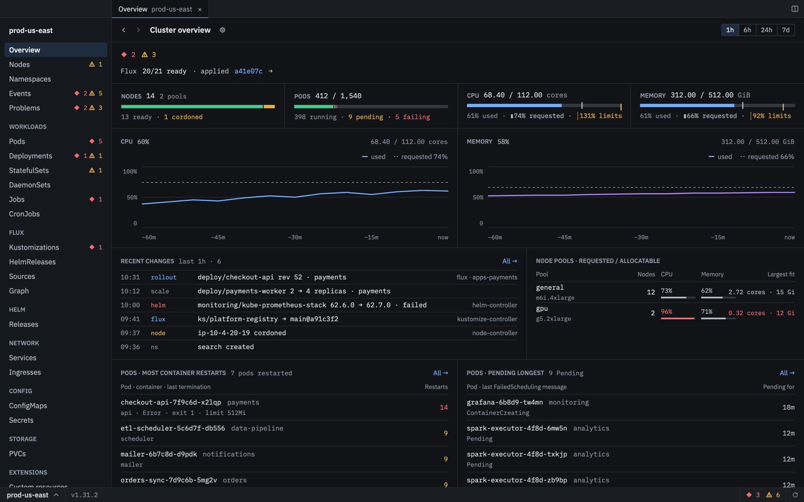
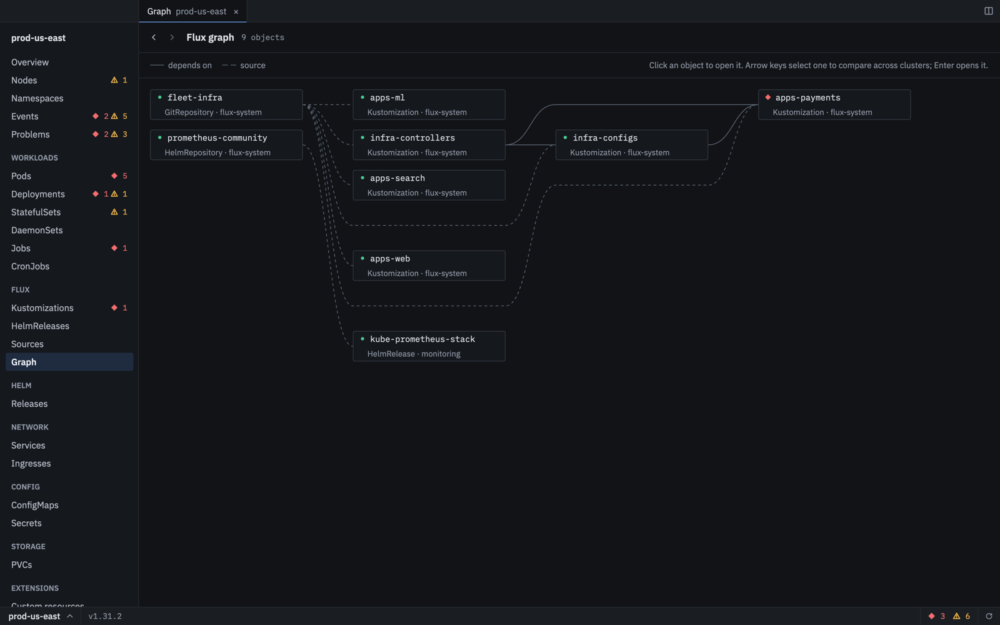

<p align="center">
  
</p>

<h1 align="center">Flock</h1>

<p align="center">A native macOS app for watching many Kubernetes clusters at once, with Flux built in.</p>

<p align="center">
  
</p>

## Install

```sh
curl -fsSL https://raw.githubusercontent.com/team-loco/flock-app/main/install.sh | sh
```

The script downloads the latest release, verifies its checksum and installs `/Applications/Flock.app`
without a Gatekeeper prompt. Set `FLOCK_VERSION=0.2.7` to pick a version or `FLOCK_INSTALL_DIR` to
install elsewhere.

Or download `Flock-<version>-arm64.zip` from [Releases](https://github.com/team-loco/flock-app/releases)
and unzip it. A browser download is quarantined; see [docs/releasing.md](docs/releasing.md#first-install-and-gatekeeper).

Apple Silicon only. Flock checks for new releases itself, verifies their signature and checksum, and
offers "Restart to update".

## What it does

- Reads your kubeconfig and shows every cluster in one window, with a cluster overview of nodes, pods,
  CPU and memory, recent changes and what needs attention
- Browses workloads, nodes, namespaces, events, network, config, storage and custom resources, with
  YAML editing, Compare across clusters and a Problems list
- Pods with logs and a shell, workload rollouts, scale, drain and cordon
- Flux: Kustomizations, HelmReleases and sources, a dependency graph and commit-to-cluster tracing
- Helm release history decoded from the cluster
- Command palette, tabs, split panes and a menu-bar health indicator; see [docs/keyboard.md](docs/keyboard.md)
- Optional Loco support, built with `--features loco`

<p align="center">
  
</p>

## Build from source

[mise](https://mise.jdx.dev) pins the toolchain; every command is a mise task.

```sh
mise run demo      # run on sample data
mise run run       # run against your kubeconfig
mise run bundle    # build an ad-hoc signed dist/Flock.app (bundle:loco for Loco)
mise run check     # fmt, clippy, tests, typos, deny
mise run shot -- overview dark   # render a screen to a PNG headlessly
```

## Docs

- [docs/releasing.md](docs/releasing.md): cutting releases, signing, updates
- [docs/decisions.md](docs/decisions.md): settled design and product decisions
- [docs/PLAN.md](docs/PLAN.md): scope and architecture

## License

Apache-2.0, see [LICENSE](LICENSE).
